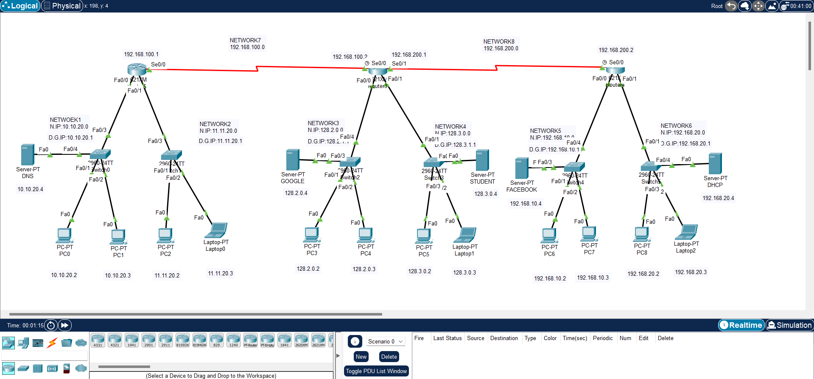

# مشروع تصميم ومحاكاة الشبكات (Cisco Packet Tracer)

مشروع عملي لتصميم ومحاكاة طوبولوجيا شبكة متكاملة باستخدام برنامج Cisco Packet Tracer**، يربط بين عدة شبكات محلية (LANs) عبر موجهات (Routers) ووصلات تسلسلية (Serial WAN)، مع تهيئة خدمات الشبكة الأساسية مثل **DNS و**DHCP** وخوادم الويب.

## مكونات وتفاصيل الشبكة
- الموجهات (Routers): 3 موجهات (Cisco 2911) متصلة فيما بينها عبر وصلات Serial (`192.168.100.0` و `192.168.200.0`) لتوجيه البيانات بين الفروع.
- المبدلات (Switches): 6 مبدلات (Cisco 2960) لتوزيع الاتصال داخل الشبكات المحلية الست (`NETWORK1` إلى `NETWORK6`).
- الأجهزة الطرفية: أجهزة حاسوب مكتبية (`PC`) ومحمولة (`Laptop`) موزعة على الشبكات الفرعية بعناوين IP مخصصة.
- الخوادم (Servers):
  - خادم DNS (`10.10.20.4`) لترجمة أسماء النطاقات.
  - خادم DHCP (`192.168.20.4`) لتوزيع عناوين IP تلقائياً.
  - خوادم خدمات ومواقع داخلية (**GOOGLE**، **STUDENT**، **FACEBOOK**) لمحاكاة الوصول للخدمات عبر الشبكة.

## مخطط الشبكة (Network Topology)

الواجهة الكاملة لتصميم الشبكة وتوزيع العناوين والاتصالات بين الموجهات والمبدلات والأجهزة الطرفية والخوادم.

## ملفات المشروع
- المشروع.pkt: ملف المحاكاة الرئيسي القابل للتشغيل مباشرة على برنامج Cisco Packet Tracer.
- network-topology.png: صورة توضيحية لمخطط الشبكة الكامل.
